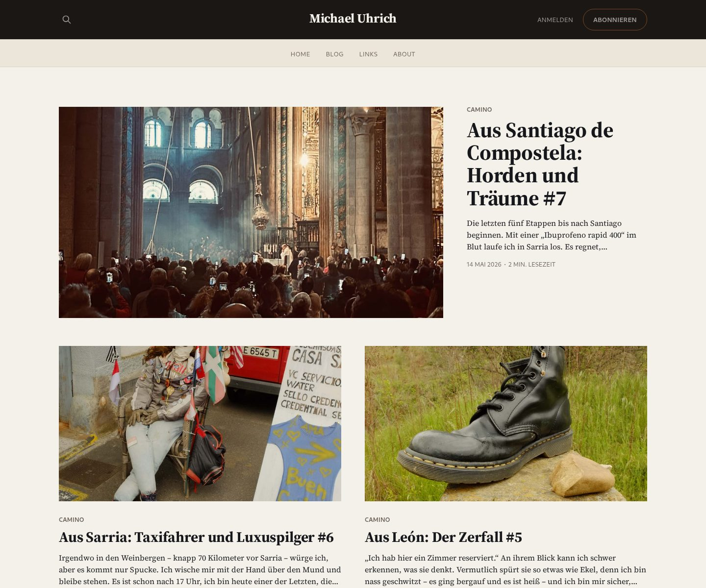

# miuh-ghost-theme

A privacy-focused Ghost theme based on
[TryGhost/Casper](https://github.com/TryGhost/Casper), used on
[michaeluhrich.xyz](https://michaeluhrich.xyz/).

The fork keeps its visual changes separate from Casper and serves selected Ghost
UI assets locally to reduce third-party requests. Overall privacy and GDPR
compliance still depend on the complete Ghost, server, analytics, and content
configuration.

[](https://michaeluhrich.xyz/)

## Highlights

- Warm editorial design with matching light and dark modes
- Custom styling isolated in `assets/css/custom.css` for easier upstream merges
- Local Portal, Search, and Comments assets
- Self-hosted Source Serif 4 font (SIL OFL 1.1), no third-party font requests
- Generated production assets included in `assets/built/`
- Automated validation on pull requests and `main`, with release-based deployment
- Requires Ghost 6.x

## Installation and updates

Build and validate the theme archive from a clean checkout:

```bash
corepack enable
pnpm install --frozen-lockfile
pnpm test:ci
```

This creates `dist/miuh-ghost-theme.zip`. In Ghost Admin, open
**Settings → Site → Theme**, select **Change theme**, and use **Upload theme**
to upload and activate the archive.

To update an existing installation, pull the latest changes from this
repository, repeat the commands above, and upload the newly generated archive.
Because this is a customized Casper fork, do not replace it with an automatic
update of the official Casper theme. For this repository, publishing a GitHub
release deploys its tagged revision through the production workflow described
below.

## Required Ghost configuration

Configure Ghost to use the local Portal, Search, and Comments assets:

```yaml
portal__url: "/assets/jsdelivr/portal.min.js"
sodoSearch__url: "/assets/jsdelivr/sodo-search.min.js"
sodoSearch__styles: "/assets/jsdelivr/sodo-search.min.css"
comments__url: "/assets/jsdelivr/comments-ui.min.js"
privacy__useGravatar: "false"
privacy__useGoogleFonts: "false"
privacy__useRpcPing: "false"
```

Without these settings, Ghost may load the corresponding resources from its
default external locations.

## Development

Requirements: Node.js 22.12 or newer and Corepack. The pnpm version is pinned in
`package.json`.

```bash
corepack enable
pnpm install --frozen-lockfile
pnpm dev
```

Useful commands:

```bash
pnpm build     # Build CSS and JavaScript into assets/built/
pnpm test      # Build the archive and validate the theme with GScan
pnpm zip       # Create dist/miuh-ghost-theme.zip
```

A VS Code Dev Container is available in `.devcontainer/` and provides the same
Node.js and pnpm toolchain.

## Delivery

Pull requests and pushes to `main` run the theme test workflow. Publishing a
GitHub release triggers production deployment from the tagged revision: GitHub
Actions installs the locked dependencies, builds the theme archive, validates
that exact archive with GScan, and deploys it to the protected `production`
environment in Ghost. The production workflow can also be started manually.

The version shown in Ghost comes from `package.json` and should be updated before
merging a release. The generated ZIP can still be uploaded manually through Ghost
Admin if the automated deployment is unavailable.

## Updating local Ghost assets

The currently vendored UI assets target Ghost 6.78.0 and were resolved on
2026-11-20:

| Asset | Version | SHA-256 |
| --- | --- | --- |
| Portal | 2.72.36 | `bf97c0a94eb564f0d3192d9ee1ea7534a0ed82c109c5111630076aed1e715583` |
| Sodo Search JavaScript | 1.9.7 | `5ff29320840e94565b12c15d90a4ab9c884a7e01783e17ac329f27dba3395688` |
| Sodo Search CSS | 1.9.7 | `8351196b62e6c27858441427a27c8be4d08f0e2b3684c4c280de7bbfe2a2160a` |
| Comments UI | 1.6.456 | `af76fd41bd86e030ddff5b7bfa627da0ae1aa7f4534184fb92270c0209a33c34` |

When updating these files:

1. Determine the Ghost version running in production.
2. Check [`defaults.json`](https://github.com/TryGhost/Ghost/blob/v6.78.0/ghost/core/shared/config/defaults.json)
   from the matching Ghost release tag. Current tags keep it at
   `ghost/core/shared/config/defaults.json`; older tags such as v6.65.0 use
   `ghost/core/core/shared/config/defaults.json`.
3. Resolve jsDelivr's version range and download that exact patch version.
4. Replace the corresponding files in `assets/jsdelivr/`.
5. Record the resolved versions and SHA-256 hashes in the table above.
6. Run `pnpm test:ci` before opening a pull request.

## License

MIT, matching upstream Casper. See [LICENSE](LICENSE).
